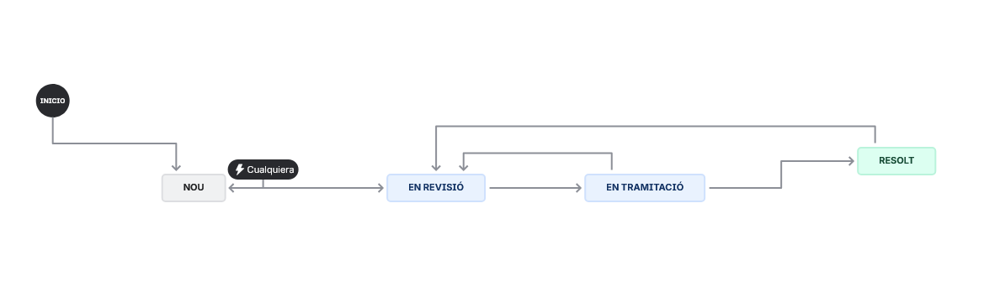
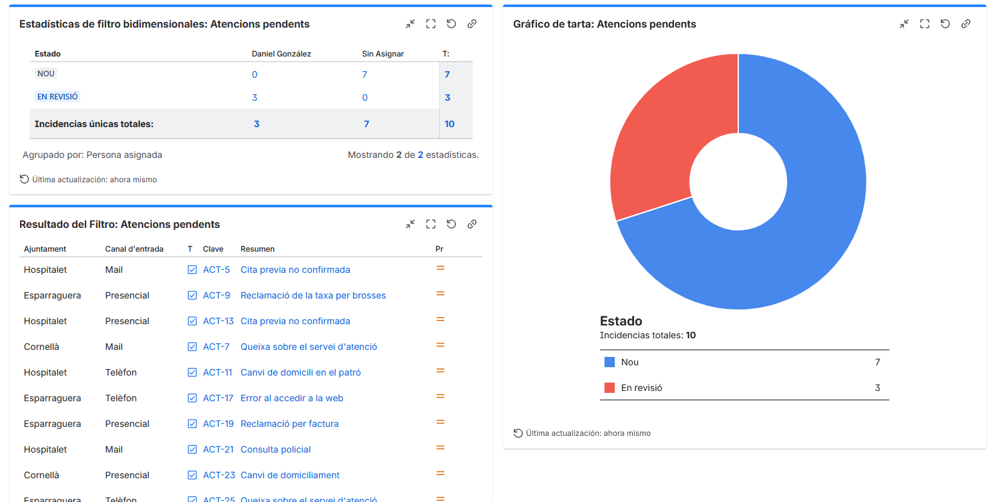
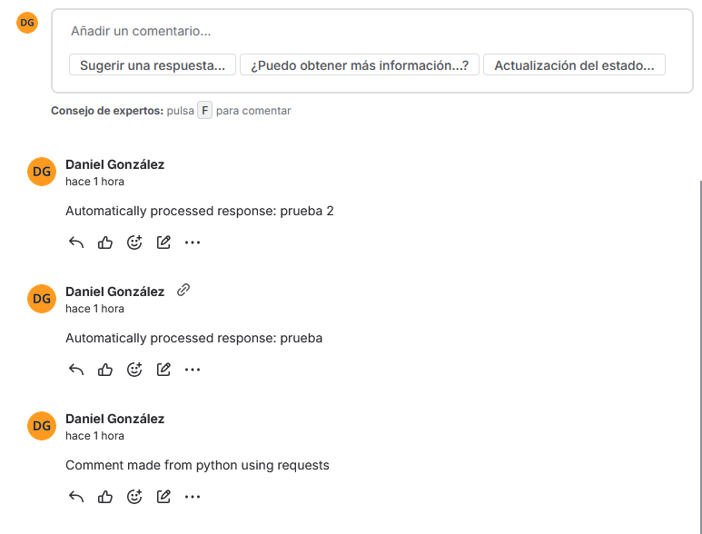
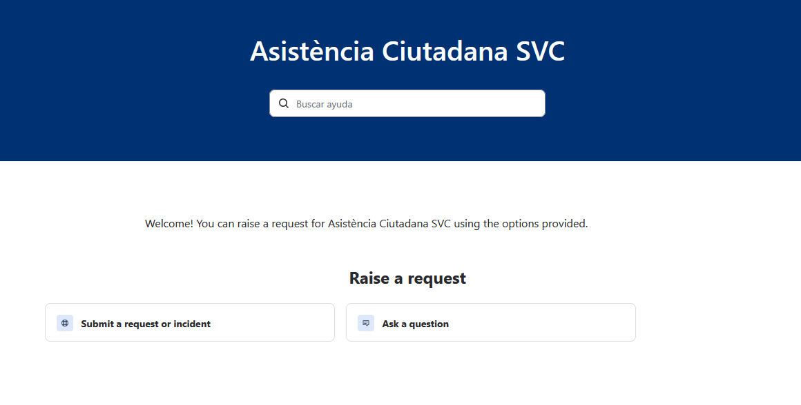
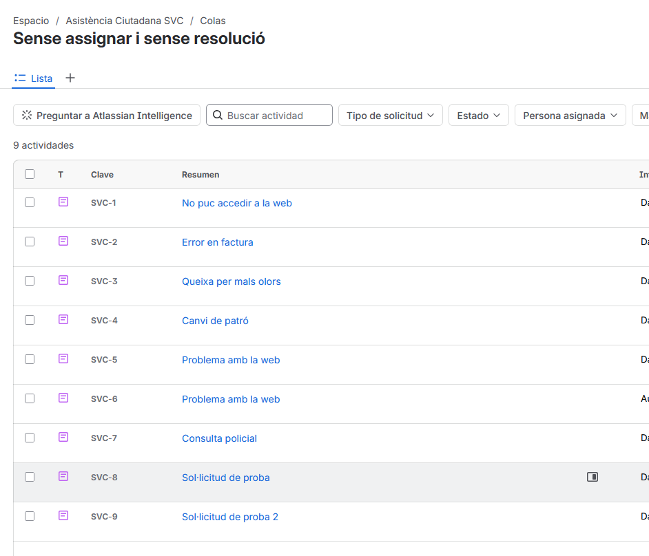
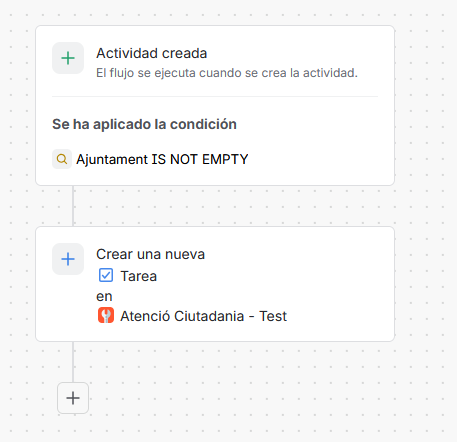
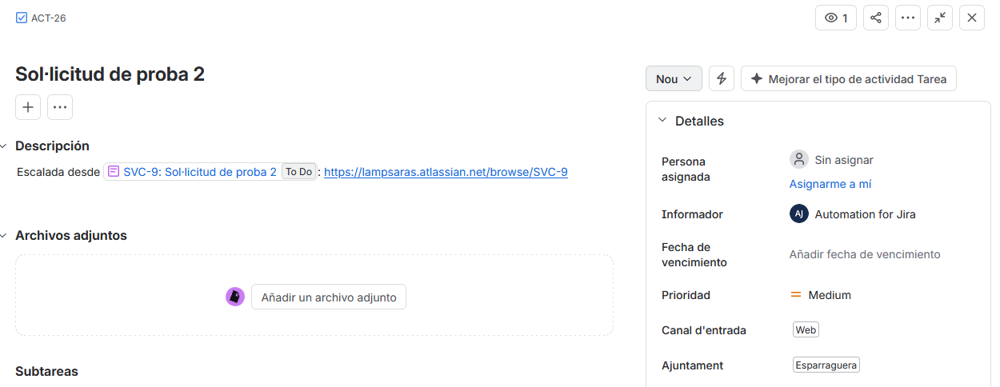

# Jira Automation: Citizen Service Request Workflow

A practice project that simulates a citizen-assistance service managed in Jira, with workflow configuration, a service portal with queues, automation rules and Python integrations built on the Jira Cloud REST API.

The scenario is modelled on a public-sector service provider: requests from citizens of several town councils arrive through different channels (phone, email, in person, web) and are processed through a defined workflow.

## What's included

**Internal work space `ACT` (Jira, company-managed)**

- Custom workflow: `New` → `In review` → `In progress` → `Resolved`, with restricted transitions (e.g. `In progress` can go back to `In review` or forward to `Resolved`, but nothing can skip the review step).
- Custom fields: `Canal d'entrada` (intake channel) and `Ajuntament` (town council), both required when creating an issue.
- Validators and post-functions on transitions.
- Notification scheme review and configuration.
- Saved JQL filters, a board, and a dashboard with filter and chart gadgets.
- Automation rules: notifications on create/resolve, and a scheduled rule that runs a JQL query to flag stale requests.

**Service desk space `SVC` (Jira Service Management, company-managed)**

- Customer portal where citizens submit requests (request types: *Submit a request or incident* and *Ask a question*).
- Agent queues defined with JQL, for example:
  - Unassigned: `assignee IS EMPTY AND resolution IS EMPTY ORDER BY created ASC`
  - Open for more than 3 days: `resolution IS EMPTY AND created <= -3d ORDER BY created ASC`
  - By priority: `resolution IS EMPTY ORDER BY priority DESC, created ASC`
- **Escalation rule between spaces:** when a request is created in `SVC`, the rule checks that the town council field is filled in and creates a linked **Task** in `ACT`, copying the relevant fields.

**Python integrations**

- `app.py`: a FastAPI webhook receiver that adds a comment to a Jira issue through the REST API.
- `comment.py`: a helper that posts a comment (Atlassian Document Format) to an issue.
- `summary.py`: exports the issues matching a JQL query to a CSV file.

## Architecture

Service desk flow (configured entirely in Jira):

```
Citizen ──► Portal (SVC) ──► Queues (JQL) ──► Agent
                │
                └─► Automation rule ──► Task in ACT (linked to the request)
```

Python integration:

```
Jira automation rule
        │  POST /webhook  (X-API-Key header)
        ▼
FastAPI service (app.py)
        │  POST /rest/api/3/issue/{key}/comment
        ▼
Jira Cloud REST API
```

## Screenshots

| | |
|---|---|
|  |  |
|  |  |
|  |  |
|  | |

## Getting started

**Requirements:** Python 3.10+, a Jira Cloud site, and an [Atlassian API token](https://id.atlassian.com/manage-profile/security/api-tokens).

```bash
git clone https://github.com/Public0Static1Void/jira_automation
cd jira_automation

python -m venv venv
# Windows:      venv\Scripts\activate
# Linux / Mac:  source venv/bin/activate

pip install -r requirements.txt
cp .env.example .env      # then fill in your values
```

`.env` variables:

| Variable | Description |
|---|---|
| `JIRA_BASE` | Your site URL, e.g. `https://your-site.atlassian.net` (no trailing slash) |
| `JIRA_EMAIL` | The email of your Atlassian account |
| `JIRA_TOKEN` | Your Atlassian API token |
| `WEBHOOK_SECRET` | A random string used to authenticate webhook calls |

Generate a secret with:

```bash
python -c "import secrets; print(secrets.token_urlsafe(32))"
```

## Usage

**Run the webhook service**

```bash
uvicorn app:app --reload
```

**Send a test request**

```bash
curl -X POST http://localhost:8000/webhook \
  -H "Content-Type: application/json" \
  -H "X-API-Key: <WEBHOOK_SECRET>" \
  -d '{"key": "ACT-1", "summary": "test"}'
```

On Windows PowerShell, use `curl.exe` and escape the inner quotes.

**Add a comment from the command line**

```bash
python comment.py ACT-1 "Comment made from Python"
```

**Export a report**

```bash
python summary.py
```

This writes `summary_YYYY-MM-DD.csv` using the JQL defined at the top of the script. The file uses `;` as the separator and UTF-8 with BOM so it opens correctly in Excel.

## Webhook responses

| Status | Meaning |
|---|---|
| `200` | Comment added |
| `400` | Request body is not valid JSON |
| `401` | Missing or incorrect `X-API-Key` |
| `422` | The `key` field is missing |
| `502` | Jira rejected the request (unknown issue, permissions or credentials) |

Distinct status codes make integration failures quick to diagnose: the cause is visible from the response alone, without reading logs first.

## Design decisions

- **Shared secret authentication.** The endpoint checks an `X-API-Key` header using a constant-time comparison, so only callers who know the secret can write to Jira.
- **Explicit error handling.** Jira failures are caught and reported as `502` instead of surfacing as an unhandled `500`.
- **Secrets in environment variables.** Nothing sensitive is stored in code, and `.env` is excluded through `.gitignore`.
- **Custom field IDs resolved by name.** `summary.py` looks up `customfield_XXXXX` IDs from the field names, so the script doesn't depend on IDs that differ between Jira sites.
- **Paginated search.** The report follows the API's pagination token instead of assuming everything fits in one response.
- **Two separate spaces with their own configuration.** `ACT` and `SVC` do not share workflow, screen or notification schemes, so changes in one cannot break the other. Global custom fields are reused instead.
- **Queues built on `resolution IS EMPTY`.** Service desk queues filter on the resolution rather than on specific status names, so they keep working if the workflow is edited.
- **Validate before escalating.** The escalation rule uses a JQL condition to check that required fields are present, so it never creates incomplete tasks, and the audit log shows why a request was skipped.
- **Explicit issue type on the created task.** See the troubleshooting case below.

## Troubleshooting case: wrong issue type on a cross-space rule

While building the escalation rule, Jira reported an error retrieving the fields for project/issue type `10001/10007`. The diagnosis used the REST API:

1. `GET /rest/api/3/project/ACT` showed that project `10001` was `ACT`, which only has the issue types *Task* and *Sub-task*.
2. `GET /rest/api/3/issuetype/10007` showed that `10007` is *Submit a request or incident*, a type that exists only in `SVC`.
3. `GET /rest/api/3/issue/createmeta/SVC/issuetypes/10007` listed the fields available on the service desk request type.

**Cause:** the *Create issue* action was set to use the same issue type as the triggering issue, so it tried to create a service-desk type of issue inside `ACT`.
**Fix:** set the issue type explicitly to *Task* in the action.

## Status and limitations

- The webhook service has been tested locally with simulated requests. Connecting it to a live Jira automation rule requires a publicly reachable URL (a server or a tunnel).
- Jira Service Management is used under Atlassian's trial period, so the `SVC` space may not remain available.
- The Jira automation rules, queues, workflow and dashboard are documented through the screenshots above.
- For production use I would add: deployment on a managed server with a fixed URL, structured logging, retries with backoff, secret rotation, and automated tests.

## Tech stack

Jira Cloud (company-managed spaces, Jira Service Management, automation, JQL) · Python · FastAPI · Uvicorn · Requests · python-dotenv

## Notes

- Never commit `.env` or your API token. If a token is ever exposed, revoke it and create a new one.
- Use `.env.example` as the template for the required variables.